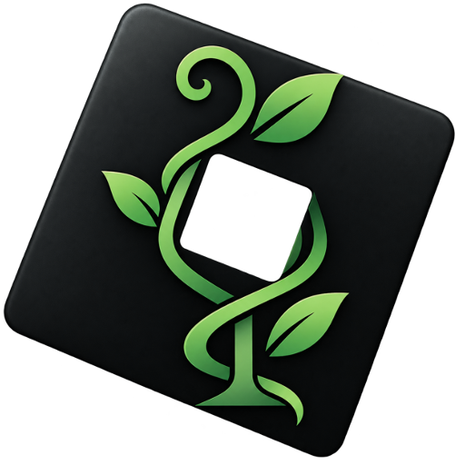

<div align="center">
<picture>
  <source media="(prefers-color-scheme: dark)" srcset="assets/vine-logo-text.png">
  
</picture>

</div>

Vine runs Roblox's macOS client unmodified (apart from two optional, documented patches) on Linux, with no root and no install. You can sign in, join experiences, and play natively.
It is an unofficial compatibility project, not affiliated with Roblox. It uses normal account sign-in and does not touch Roblox's anti-cheat (see [Scope](#scope)).

## Status

| | |
|---|---|
| **Works** | Start-up, sign-in (stays signed in), game join, rendering (OpenGL, Vulkan through Zink optional), keyboard and mouse camera, audio, antialiasing |
| **Rough edges** | Frame rate is below native Windows (see [docs/TODO.md](docs/TODO.md)); closing from inside a game can take several tries; voice chat microphone untested |
| **Tested on** | CachyOS, KDE Plasma (Wayland / Xwayland), AMD RX 7800 XT, Roblox 0.742.0.7421053, Darling 0.1.20260608 |

## Quick start

Requirements: Linux with unprivileged user namespaces, Xorg or Xwayland, Mesa (OpenGL 3.2+ core), `clang` + `lld` + `llvm` tools (to build the shims), `pacat` (audio), Python 3 with PySide6 (settings window).

```sh
# One-time setup
#  1. Unpack Darling's release debs into .work/darling-root (see docs/RESEARCH.md §5)
#  2. Put Roblox's macOS client (RobloxPlayer.app) in artifacts/mac/
shims/build-ffmpeg.sh && shims/build.sh      # build the shim layer

./vine-launcher.py                           # settings window: Launch / Stop
# or from a terminal:
VINE_DISPLAY=:0 tests/run-roblox-darling.sh  # on your desktop
tests/run-roblox-darling.sh 120              # hidden test display; screenshots in logs/screens
```

The first launch needs a sign-in (Quick Login: Roblox shows a code to enter on a signed-in device).

### Settings

The settings window writes `~/.config/vine/vine.conf`; `tests/run-roblox-darling.sh` reads the same file, and environment variables of the same names override it.

| Setting | Variable | Notes |
|---|---|---|
| Window | `VINE_DISPLAY` | `desktop`, a display such as `:0`, or empty for a hidden test display |
| Renderer | `VINE_RENDERER` | `gl` (default) or `zink` (OpenGL over Vulkan; slower on AMD) |
| Camera sensitivity | `VINE_MOUSE_SENSITIVITY` | multiplier while the camera holds the mouse |
| Frame rate overlay | `VINE_FPS_OVERLAY` | Mesa HUD |
| Antialiasing on AMD | `VINE_GL_FULL_RENDERER=1` turns the fix off | hides "AMD" from Roblox's GPU name (see [docs/RESEARCH.md](docs/RESEARCH.md)) |
| Audio | `VINE_DARLING_AUDIO` | host playback (default) or Darling's audio |
| Network protocol | `VINE_RBXTRANSPORT` | RakNet (default); RbxTransport is cut after ~10 s under Darling |
| Fast start-up | `VINE_NO_THROTTLE_PATCH=1` turns it off | removes Roblox's start-up render throttle |
| Diagnostics | `VINE_TRACE_UDP`, `tests/profile.sh` | network trace; per-thread profile of a running game |

## How it works

Darling runs the macOS binary; its macOS frameworks are incomplete, so Vine **wraps** them: each framework or system library is re-exported from a renamed copy, with fixes and missing symbols added (`shims/`). Details and the layer diagram: [docs/ARCHITECTURE.md](docs/ARCHITECTURE.md).
Typical fixes: wrong or missing system calls, a slow memory and locking layer, audio, input, cookies and Keychain, GPU details Roblox reads. Every fix is backed by a regression test in `tests/darwin/` that runs inside Darling.

Credit: many findings were cross-checked against, or first reported by, [MacOBlox](https://github.com/aubree-lat/MacOBlox), a project on the same route. Vine's code is its own; where a finding is theirs the source and docs say so.

## Repository layout

```
vine-launcher.py     settings window (Qt)
shims/               Darling shim layer: frameworks.m, kernel.c, pthread.c, platform.c, ...
patches/             optional, structure-checked patches of Roblox's binary (--check / --undo)
tests/               launcher scripts, Darwin regression tests (tests/darwin), host tests, diagnostics
docs/                RESEARCH, ARCHITECTURE, DECISIONS, COMPATIBILITY, TODO, evidence/
assets/              logos and screenshots
```

Not in the repository: Roblox's client (`artifacts/`), Darling and build output (`.work/`), run logs (`logs/`).

## Scope

- **Windows client under Wine/Proton:** blocked. Roblox's Hyperion anti-tamper reports "Wine is not supported." and exits on every Wine and Proton build tried. Vine does not bypass it ([docs/DECISIONS.md](docs/DECISIONS.md) D1).
- **Android client:** works natively through [Sober](https://sober.vinegarhq.org/); Vine only has a diagnostics script for it (`tests/sober-stages.sh`).
- **macOS client on Darling:** the active route, this project.

Roblox's own client is Roblox's property and is not distributed here.

## Documentation

[docs/RESEARCH.md](docs/RESEARCH.md) (findings, evidence) · [docs/ARCHITECTURE.md](docs/ARCHITECTURE.md) · [docs/DECISIONS.md](docs/DECISIONS.md) · [docs/COMPATIBILITY.md](docs/COMPATIBILITY.md) · [docs/TODO.md](docs/TODO.md)

## Reproducing the Windows research

```sh
tests/env.sh                                     # host matrix
# put Roblox packages in artifacts/win (not committed)
tests/route-a-wine-startup.sh                    # system Wine
tests/route-a-wine-startup.sh ~/.local/share/Steam/compatibilitytools.d/GE-Proton11-1/files/bin/wine
```

Needs `wine`, `xvfb-run`, and `llvm-objdump`. Nothing is installed on the host; prefixes go in `.work/`.

## License

GPL-3.0 (see [LICENSE](LICENSE)), matching Darling. Roblox, macOS and Darling are not part of this repository and keep their own licenses.
